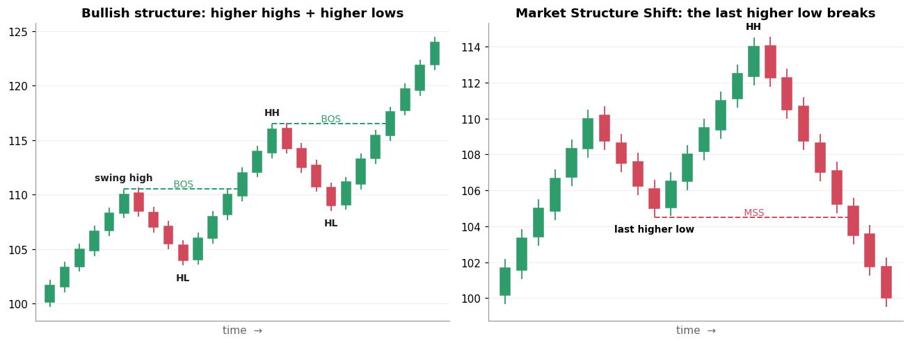

# 1. Prerequisites: candles, swings, market structure

[← Index](README.md) · Next: [2. HTF →](02_htf.md)

*Not on the board. Every other topic assumes these four ideas.*

## 1.1 A candle (OHLC)

Each candle summarises one time period (1 minute, 15 minutes, 1 day, ...):

```
      |   <- High  (highest traded price)
    +---+ <- Close (green candle: closed higher than it opened)
    |   |    body = Open..Close
    +---+ <- Open
      |   <- Low   (lowest traded price)
```

- **Body** = open to close. A big body means one side controlled the period.
- **Wick** (shadow) = the parts outside the body. A long wick means price went there and was **rejected**.
- **Green** = close > open. **Red** = close < open.

ICT ideas rely heavily on the difference between a **wick** through a level ("it touched it") and a
**close** through a level ("it accepted it").

## 1.2 Swing high / swing low

- **Swing high**: a candle whose high is higher than the highs of the candles on both sides of it.
  The common 3-candle definition: the middle candle's high > the left and right candles' highs.
- **Swing low**: the mirror image, a low with higher lows on both sides.

Swing points are where buy and sell **stop orders** collect (see [Liquidity Pool](04_liquidity_pool.md)).

## 1.3 Market structure: trend as a sequence of swings



- **Uptrend** = higher highs (HH) + higher lows (HL). **Downtrend** = lower highs (LH) + lower lows (LL).
- **BOS (Break of Structure)**: price **closes** beyond the previous swing high in an uptrend (or swing
  low in a downtrend). The trend is **continuing**. (Left picture.)
- **MSS (Market Structure Shift)**, also called CHoCH (Change of Character): in an uptrend, price
  breaks below the **last higher low**. The trend may be **reversing**. (Right picture.) ICT
  traders usually want an MSS to happen *with displacement* (section 6).

## 1.4 Timeframes

The same market can be viewed as monthly, weekly, daily, 4h, 1h, 15m, 5m or 1m candles. A daily
candle contains about 25 fifteen-minute candles of the Indian cash session. **Higher timeframes move slower and carry more weight.**
That is the whole idea behind [HTF](02_htf.md).

## Why it matters

Every ICT term is defined in terms of these pieces. A liquidity pool sits at swing highs and lows, a sweep is a
wick through one, displacement is big-bodied candles, and an FVG is a 3-candle pattern. If you can't
mark swings reliably, nothing later works.

## Common mistakes

- **Marking every wiggle as a swing.** Use one consistent rule (e.g. the 3-candle rule) on one timeframe.
- **Counting a wick as a break of structure.** BOS and MSS need a candle **close** beyond the swing.

## Check yourself

1. A candle's wick goes above yesterday's high but it closes below it. Did price "accept" above the high?
2. In an uptrend, which swing must break for an MSS: the last higher high or the last higher low?
3. What's the difference between a BOS and an MSS?

<details><summary>Answers</summary>

1. No. It traded there and was rejected (a wick, not a close).
2. The last higher low.
3. A BOS breaks structure *in the direction of the trend* (continuation). An MSS breaks the swing that
   was protecting the trend (possible reversal).
</details>
