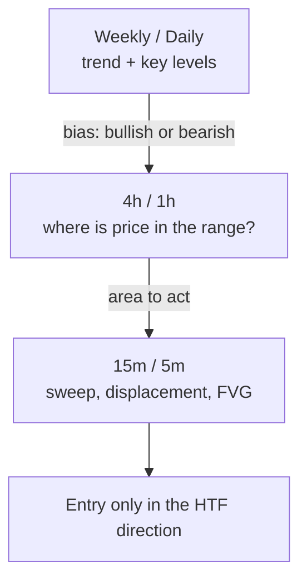
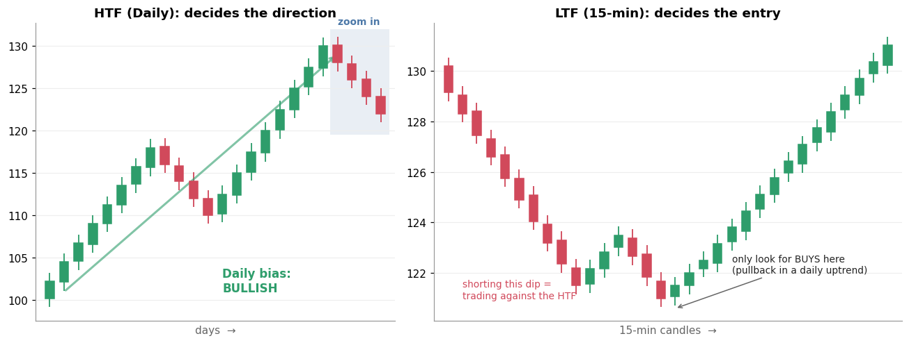

# 2. HTF — Higher Time Frame (bias)

[← 1. Prerequisites](01_prerequisites.md) · [Index](README.md) · Next: [3. Premium / Discount →](03_premium_discount.md)

## Definition

**HTF** means looking at a **higher timeframe** (monthly, weekly, daily, sometimes 4h) to decide
the **bias**: are you looking for buys or sells today? You then drop to a **lower timeframe (LTF)**
(15m, 5m, 1m) only to time the entry.

> HTF answers **"which direction?"**. LTF answers **"where exactly do I get in?"**

## Why it matters

- Big participants work on big timeframes. A 5-minute "reversal" against a strong daily uptrend is
  usually just a pullback.
- It removes half the decisions. With a bullish bias, you ignore every short setup.
- Every later concept starts from the HTF. Premium/discount is measured on the HTF range,
  the liquidity targets are HTF highs and lows, and so on.

## How ICT traders read the bias (common checklist)

1. Daily/weekly **market structure**: HH/HL (bullish) or LH/LL (bearish)?
2. **Which liquidity is price drawing toward?** ("draw on liquidity"): an old high above, or an old low below?
3. Is price in **premium or discount** of the HTF range? (next section)
4. Has the HTF just **swept** a major high or low? That could flip the bias.

## Example

- **Left:** on the daily chart, NIFTY (illustrative numbers) is making higher highs and higher lows, so the **bias is bullish**.
- **Right:** zoomed into 15-minute candles, the last few days look like a *downtrend*. Without the
  HTF you might short it. With the HTF you see a **pullback inside a daily uptrend**, so you wait for
  15-minute signs that the pullback is ending and look only for longs.

## Common mistakes

- **Too many timeframes.** Pick two or three (e.g. Daily → 1h → 5m), not six.
- **Bias that changes every hour.** The HTF bias should last days, not minutes.
- **Treating bias as a trade.** Bias tells you where to look. You still need a setup.

## Check yourself

1. The weekly and daily charts are making lower highs and lower lows. A 5-minute chart shows a bullish MSS. What do you do?
2. Why do you need an LTF at all if the HTF gives the direction?

Answers

1. Treat it as a likely pullback inside a downtrend. No long. Wait for the pullback to finish and look for shorts.
2. An HTF candle can be wide. The LTF lets you enter with a tight, well-defined stop.

