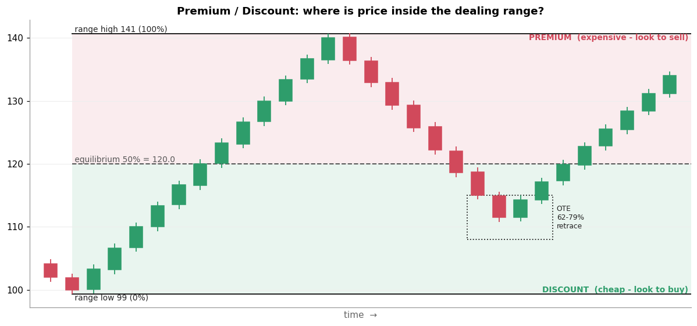

# 3. Premium / Discount

[← 2. HTF](02_htf.md) · [Index](README.md) · Next: [4. Liquidity Pool →](04_liquidity_pool.md)

## Definition

Take a **dealing range**: the most recent significant swing low to swing high (or high to low).

- **Equilibrium** = the 50% midpoint of that range.
- **Premium** = the upper half. Price is "expensive" relative to the range.
- **Discount** = the lower half. Price is "cheap" relative to the range.

**Rule of thumb: buy in discount, sell in premium.** In a bullish HTF bias, wait for price to pull back
into the discount half before looking for longs.

Formula for a range from low *L* to high *H*:

```
equilibrium = L + 0.5 × (H − L)
premium     = above equilibrium
discount    = below equilibrium
```

## Why it matters

- It stops you **chasing**. Buying at the top of a leg means a wide stop and a poor risk-to-reward ratio.
- It gives a **location** filter. Setups (sweep, FVG) count only when they appear in the right half.
- It is the same idea as "buy the dip in an uptrend", with the dip measured precisely.

## OTE (Optimal Trade Entry), a refinement

Many ICT traders narrow the discount further to the **62%–79% retracement** of the leg (a Fibonacci
zone; 70.5% is often quoted as the "sweet spot"). This isn't on your board, but you'll hear it.

## Example



- The rally runs from **99 → 141**, so equilibrium = 99 + 0.5 × 42 = **120**.
- The pullback falls through 120 into **discount** and reaches the OTE box around 108–115.
- With a bullish HTF bias, this is where a long setup becomes interesting. Above 120 (premium), longs are
  ignored.

Worked check with NIFTY-style numbers: weekly range 24,000 → 25,000, equilibrium = 24,500. If the bias
is bullish and price is at 24,850, you are in **premium**: no new longs. At 24,300 you are in **discount**.

## Common mistakes

- **Picking the wrong range.** Use the swing low and swing high that produced the current move, on the
  timeframe you use for bias. Different ranges give different answers. This is one of the method's subjective points.
- **Treating discount as a buy signal.** Price can stay in discount and keep falling. Discount is a
  *location*, not a *trigger*.

## Check yourself

1. Range low 1,800, high 2,000. Price is at 1,930. Premium or discount?
2. Bias is bearish. In which half do you look for shorts?

<details><summary>Answers</summary>

1. Equilibrium = 1,900. 1,930 is above it, so **premium**.
2. Premium (the upper half).
</details>
