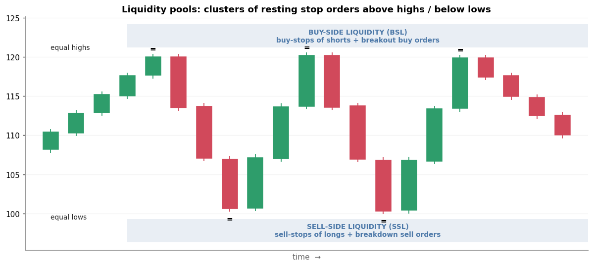

# 4. Liquidity Pool

[← 3. Premium / Discount](03_premium_discount.md) · [Index](README.md) · Next: [5. Liquidity Sweep →](05_liquidity_sweep.md)

## Definition

A **liquidity pool** is a price area where many **resting orders**, mostly stop-losses and
breakout entries, are likely sitting.

- **Buy-side liquidity (BSL)** sits **above** highs. Short sellers put their buy-stop (stop-loss) there,
  and breakout traders put buy-stop entries there.
- **Sell-side liquidity (SSL)** sits **below** lows. Long holders put their sell-stops there, and breakdown
  traders put sell-stop entries there.

Typical places:

| Pool | Why orders gather there |
|---|---|
| **Equal highs / equal lows** ("double top/bottom") | Textbook stop placement, so very obvious |
| Previous day / week high and low (PDH/PDL, PWH/PWL) | Everyone watches them |
| Session highs/lows (e.g. the Asian session range) | Short-term traders' stops |
| Trendline touches, round numbers | Retail-style stop clusters |

## Why it matters

ICT's core claim: **large players need someone to trade against.** To buy a big position they
need sellers. A cluster of sell-stops below a low *is* a block of sell orders. So price is often
"drawn" to these pools, and then either **reverses** after taking them (a sweep, next section) or
**continues** through them (a breakout).

In practice, liquidity pools give you:
1. **Targets.** Where is the nearest opposite-side pool? That is where a trade might go.
2. **Warning zones.** Don't put your own stop right at an obvious pool.

## Example

The stock tops out three times near 120 (**equal highs**) and bottoms twice near 100 (**equal lows**).
- Above 120: BSL, made up of the stops of everyone who shorted the "triple top".
- Below 100: SSL, made up of the stops of everyone who bought the "double bottom".

An ICT trader expects price to raid one of these pools before the real move.

## Common mistakes

- **Every high is liquidity.** Technically true, but focus on the *obvious* ones: equal highs and lows, prior
  day/week, session extremes.
- **Treating a pool as support/resistance.** It is the opposite. Pools are *magnets* that are expected
  to be taken, not walls expected to hold.

## Check yourself

1. You're long with your stop just under a clean double bottom. Why might an ICT trader call that
   dangerous?
2. In a bullish bias, which pool is the likely *target*, and which is the likely *raid before entry*?

Answers

1. Your stop is part of the sell-side liquidity pool, so it is exactly what a sweep would take.
2. Target: buy-side liquidity above (old highs). Raid first: sell-side liquidity below (old lows).

