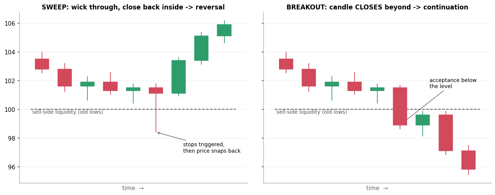

# 5. Liquidity Sweep

[← 4. Liquidity Pool](04_liquidity_pool.md) · [Index](README.md) · Next: [6. Displacement + Speed →](06_displacement_speed.md)

## Definition

A **liquidity sweep** (also called a *stop hunt*, *raid* or *liquidity grab*) happens when price **trades through a
liquidity pool, triggers the stops resting there, and then quickly comes back** to the other side of the level.

The key detail is a **wick through, close back inside**:

| | Sweep | Breakout |
|---|---|---|
| Goes through the level? | Yes, with a wick | Yes |
| **Candle closes** beyond the level? | **No**, it closes back inside | **Yes** |
| What happens next | Reversal away from the level | Continuation, and a retest of the level from the other side holds |

Some traders use "sweep" for the wick-only version and "run" for a close through. Definitions vary.

## Why it matters

- It is the "trap" in ICT's story. Stops trigger, late breakout traders jump in, and the large player
  fills their order against them. Then price reverses.
- It gives a **logical stop**: just beyond the sweep's extreme wick. If price goes back there, the
  idea is wrong.
- **A sweep alone is not an entry.** ICT traders want a sweep **followed by displacement** in the
  opposite direction (next section). That is the "V" on the board.

## Example

Both charts start the same way, with price drifting down toward old lows at 100.

- **Left (sweep):** one candle wicks to 98.4, below 100, setting off the sell-stops, but closes at 101.1,
  back above. The next candles rally hard. The sell-side liquidity was a *fuel stop*, not a breakdown.
- **Right (breakout):** the candle **closes** at 98.9, below the level. The retest from below fails at 99.9,
  and price keeps falling. That is acceptance, not a sweep.

## Common mistakes

- **Calling every wick a sweep.** Without a clear pool (equal lows, PDL, session low) there is nothing to sweep.
- **Entering on the sweep candle itself.** You don't yet know whether it is a sweep or the first candle of a breakout.
  Wait for confirmation (displacement / MSS).
- **Ignoring the HTF.** A sweep of lows in a strong HTF downtrend often fails. Sweeps work best *in the HTF direction*:
  sweep lows in a bullish bias, sweep highs in a bearish bias.

## Check yourself

1. Price takes out yesterday's low by 0.3% and closes the 15-minute candle 0.2% *below* it. Sweep or not (yet)?
2. Where does the stop go on a long trade taken after a sweep of lows?

Answers

1. Not a confirmed sweep. It closed beyond the level. Wait: if the next candles reclaim the level with
   force, it may still become one. If not, it's a breakdown.
2. Just below the lowest wick of the sweep, with a small buffer.

