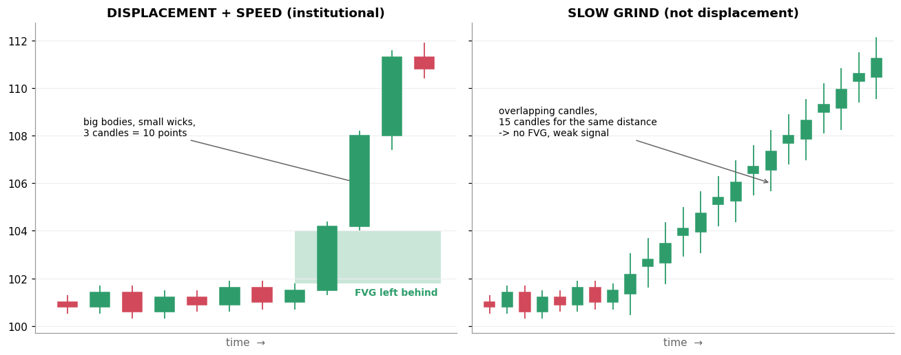

# 6. Displacement + Speed

[← 5. Liquidity Sweep](05_liquidity_sweep.md) · [Index](README.md) · Next: [7. FVG / IFVG →](07_fvg_ifvg.md)

> **Order note:** this is item 6 on the board but is taught before item 5 (FVG/IFVG), because
> displacement is what *creates* an FVG.

## Definition

**Displacement** is a **strong, fast, one-directional move**: a few candles with **large bodies and small
wicks** that cover a lot of distance quickly. **Speed** is the "fast" part: the same distance covered in
3 candles means much more than the same distance covered in 15.

Signs of displacement:
- Candle bodies clearly **larger than recent average** (e.g. 2–3× the average body or ATR).
- **Small wicks**: little hesitation.
- It **breaks structure** (BOS or MSS) and usually **leaves a Fair Value Gap** behind.

## Why it matters

- It is ICT's evidence that **large orders** have entered. Small traders can't push price that fast.
- It **confirms the sweep**. Sweep alone = maybe. Sweep followed by displacement the other way = the
  trap likely worked.
- It **creates the entry zone**. The FVG left behind is where ICT traders look to enter on the pullback.

## Example



- **Left:** after a quiet range around 101, three large green candles carry price from 101.5 to 111.3. The
  move is so fast that candle 1's high and candle 3's low don't overlap, so a **Fair Value Gap** (green) is
  left behind.
- **Right:** the same distance taken in 15 small, overlapping candles. That is a **grind**, not
  displacement. There is no FVG and the move carries little information.

## A mechanical definition (useful for testing)

```text
body          = |close − open|
avg_body_20   = mean(body over last 20 candles)
displacement  = body > 2 × avg_body_20   AND   wick fraction < 30%
                AND close breaks the most recent swing in that direction
```

The thresholds (2×, 30%) are choices, not ICT rules. Test them; don't assume them.

## Common mistakes

- **Calling any big candle displacement.** It should come *from a meaningful place* (after a sweep, or out of a
  range) and break structure.
- **Ignoring news.** A 9:15 gap or a results-day spike is "fast", but it is a news event, not necessarily
  smart-money positioning.

## Check yourself

1. Two moves both travel 1%. One takes 2 candles, the other 12. Which is displacement?
2. What does displacement usually leave behind?

<details><summary>Answers</summary>

1. The 2-candle move.
2. A Fair Value Gap (and a break of structure).
</details>
