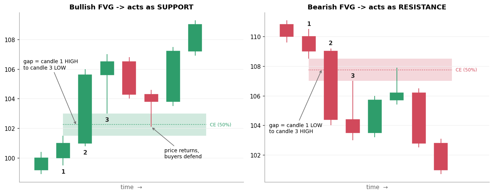
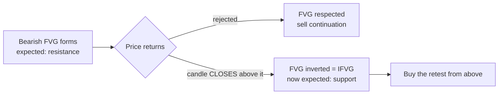
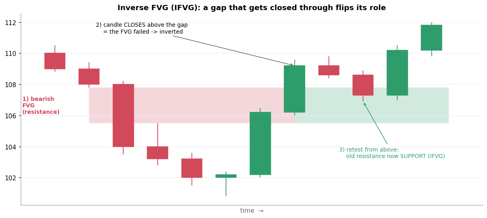

# 7. FVG and IFVG — Fair Value Gap / Inverse Fair Value Gap

[← 6. Displacement + Speed](06_displacement_speed.md) · [Index](README.md) · Next: [8. London session →](08_london_session.md)

## 7.1 FVG: Fair Value Gap

### Definition

A **3-candle pattern** where the middle candle moves so fast that the wicks of candle 1 and
candle 3 **do not overlap**. The empty space between them is the gap.

| Type | Condition | Gap zone | Expected role |
|---|---|---|---|
| **Bullish FVG** | candle 3 **low** > candle 1 **high** | candle 1 high → candle 3 low | **support** when price comes back down into it |
| **Bearish FVG** | candle 3 **high** < candle 1 **low** | candle 3 high → candle 1 low | **resistance** when price comes back up into it |

The **CE (Consequent Encroachment)** is the 50% midpoint of the gap. Many traders use it as the precise
entry or as the "must hold" line.

The board's candle drawing with teal horizontal lines most likely marks exactly this: lines from candle 1's
wick and candle 3's wick showing the gap between them.

### Why it matters

- ICT's idea is that during the gap, price moved through that zone so fast that only one side traded. The
  market is said to "rebalance" by coming back to fill it.
- In practice, it gives a **specific, small zone** to enter on a pullback after displacement, with a
  stop just beyond the swing (or the sweep).

### Example (left picture above)

- Candle 1 high = **101.5**. Candle 2 rockets from 101 to 105.6. Candle 3 low = **103.0**.
- 103.0 > 101.5, so this is a **bullish FVG from 101.5 to 103.0**, with CE = 102.25.
- Two candles later price dips to 102.1 (inside the gap, just below CE), buyers defend, and price rallies to 109.

## 7.2 IFVG: Inverse Fair Value Gap

### Definition

An **FVG that fails**: price **closes through it** instead of respecting it. ICT traders then flip its
role. A failed **bearish** FVG becomes **support**, and a failed **bullish** FVG becomes **resistance**. It's
the same "old resistance becomes new support" idea, applied to a gap.

### Example (picture above)

1. A sharp drop leaves a **bearish FVG from 105.5 to 107.8** (red).
2. Price later rallies and a candle **closes at 109.2, above the top of the gap**. The FVG has failed and is now an **IFVG**.
3. Price pulls back to 106.9 *into* the old gap, holds, and continues up. The old resistance acted as **support**.

### Why IFVGs matter

- They often mark a **change of direction**. Sellers who defended the gap are now trapped.
- After a sweep of lows, the displacement up often closes through a bearish FVG left by the decline.
  That inversion is the confirmation many ICT traders wait for.

## Common mistakes

- **Marking every tiny gap.** Count FVGs only when they come from displacement and sit in the right place
  (discount for longs, premium for shorts, after a sweep).
- **A wick through ≠ an inversion.** An IFVG requires a candle **close** beyond the gap.
- **Assuming all gaps get filled.** Many strong trends leave FVGs unfilled for a long time.

## Check yourself

1. Candle 1: high 250. Candle 2: big green. Candle 3: low 253. Bullish FVG? Where is the zone and the CE?
2. A bullish FVG at 1,200–1,210 gets a candle that closes at 1,195. What is it now, and what role does it play?

Answers

1. Yes. Zone 250–253, CE 251.5.
2. An IFVG (an inverted bullish FVG). It now acts as **resistance** if price rallies back into 1,200–1,210.

