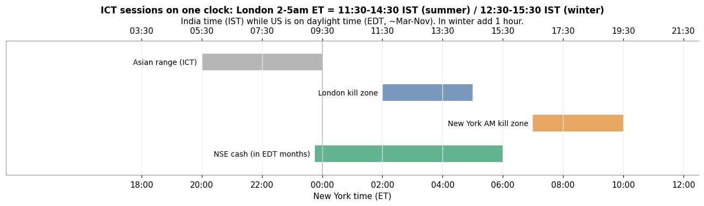

# 8. London session, 2am – 5am (New York time)

[← 7. FVG / IFVG](07_fvg_ifvg.md) · [Index](README.md) · Next: [9. Putting it together →](09_putting_it_together.md)

*The red note in the board's top-right corner.*

## Definition

ICT teaches that setups are most reliable inside specific time windows called **kill zones**, when large
volume arrives. The **London kill zone** is **2:00–5:00 am New York time**, around the London open.

ICT always quotes **New York local time**. The board says "EST", but in summer New York is on EDT. The
window follows New York's clock, so its time in India changes with US daylight saving:

| Period | New York | London kill zone in **IST** |
|---|---|---|
| US daylight time (EDT, UTC−4), ~2nd Sun of March → 1st Sun of November | 2:00–5:00 am | **11:30 am – 2:30 pm IST** |
| US standard time (EST, UTC−5), ~November → March | 2:00–5:00 am | **12:30 pm – 3:30 pm IST** |

(IST = UTC+5:30. EDT → IST is +9h30m, EST → IST is +10h30m. On today's date, 2026-10-11, the US is on EDT. It switches to EST on 1 Nov 2026.)

Other ICT windows (definitions vary by source):

| Window | New York time |
|---|---|
| Asian range (often used as the liquidity to be raided) | ~8:00 pm – midnight |
| **London kill zone** | **2:00 – 5:00 am** |
| New York AM kill zone | ~7:00 – 10:00 am |

## Why it matters

- The usual ICT story for London: during the quiet **Asian session** a range forms, and equal
  highs and lows build up liquidity. In the London window, price **sweeps one side** of the Asian range, **displaces** the
  other way, and often sets the **high or low of the day**.
- Time is a filter. A sweep + FVG at 3:30 am NY counts. The same pattern in a dead hour is ignored.

## Example (EUR/USD, a summer day, with IST in brackets)

1. **Asian range:** from 8 pm to midnight NY (5:30–9:30 am IST), EUR/USD stays between 1.0850 and 1.0872, and its
   lows at 1.0850 are tested twice (equal lows = sell-side liquidity).
2. **3:10 am NY (12:40 pm IST)**, inside the London window: a 15-minute candle wicks to 1.0842, below the Asian
   low, and closes back at 1.0853. That is a **sweep in the kill zone**, so it counts.
3. The next candles displace up and leave an FVG. That is the setup in section 9.
4. The same wick-and-reclaim at 6:30 am NY (4:00 pm IST), after the window, would be **ignored** by a strict ICT trader.

## Common mistakes

- **Using the wrong clock.** Converting from "EST" in summer puts you one hour off. Always convert from New York local time.
- **Treating the window as a signal.** Time is a filter. You still need the sweep, the displacement and the FVG.
- **Copying forex times onto stocks without testing.** See below.

## Relevance to Indian markets (read this)

- The kill zones were designed for **forex and US index futures**, which trade around the clock.
- The **NSE cash session (9:15 am – 3:30 pm IST)** overlaps the London window: 11:30–14:30 IST in summer.
  The pattern can therefore be *looked for* on Nifty intraday, but nothing guarantees that London's
  open drives Indian stocks. NSE's own 9:15 IST open is the more natural candidate. Whether the London
  window adds anything on NSE is an open question.
- For an Indian equity trader, the transferable idea is **"setups at session opens, after a range has
  built liquidity"**, not the exact clock times.
- Your own 5-minute research (root `CLAUDE.md`, 2026-10-09) found that no time-of-day setup survived costs on
  NSE stocks. Any kill-zone rule should be tested the same way before you use it.

## Check yourself

1. It is January. What IST time does the London kill zone start?
2. Why do ICT traders care about the Asian range before London?

Answers

1. 12:30 pm IST (EST is UTC−5, so add 10h30m to 2:00 am).
2. Its highs and lows are liquidity pools that the London session often sweeps before the real move.

