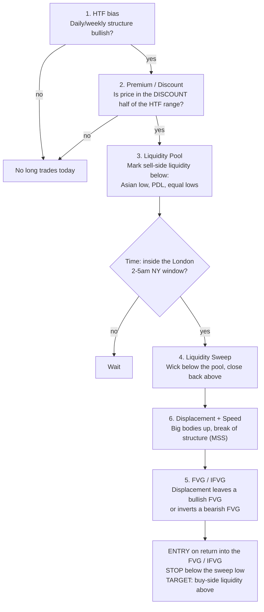
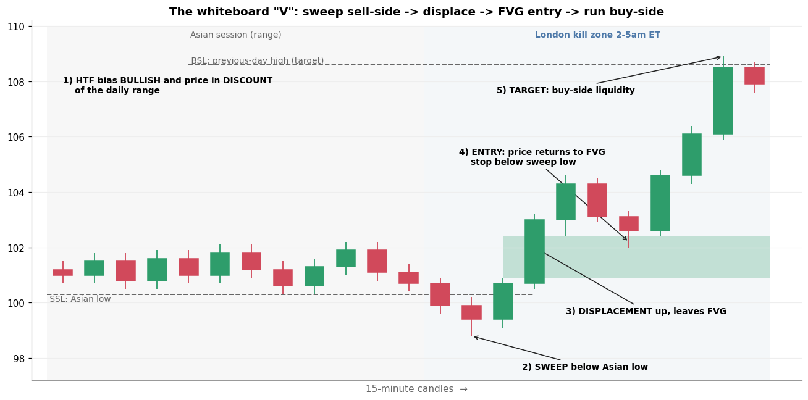

# 9. Putting it together: the whiteboard "V"

[← 8. London session](08_london_session.md) · [Index](README.md)

The board's numbered list is a **checklist**, done in order. The big **V** drawing is what the
checklist looks like on a chart: price drops into a liquidity pool, sweeps it, and reverses sharply.

## The sequence (bullish version; flip everything for bearish)

## Worked example

| Step | What you see | Board term |
|---|---|---|
| 1 | Daily structure is bullish and price is in the **discount** half of the daily range | HTF, Premium/Discount |
| — | Overnight (Asian session) price chops in a 100.3–102.2 range, building **sell-side liquidity** under 100.3 | Liquidity Pool |
| 2 | In the London window, price drops to **98.8**, **below the Asian low**, then closes back above 100.3 | Liquidity Sweep |
| 3 | Two large green candles drive from 100.7 to 104.3, breaking structure | Displacement + Speed |
| — | Candle 1's high (100.9) and candle 3's low (102.4) don't overlap, leaving a **bullish FVG 100.9–102.4** | FVG |
| 4 | Price pulls back to 102.0, **into the FVG**. A limit buy at the FVG top fills at **102.4**. Stop below the sweep at **98.6** | FVG entry |
| 5 | Price runs to **108.9**, taking the **previous-day high** (buy-side liquidity at 108.6) | Liquidity Pool as target |

Risk = 102.4 − 98.6 = 3.8. Reward = 108.6 − 102.4 = 6.2, so the trade makes about **1.6R**. This is an idealised picture:
in real charts many sweeps keep going, many FVGs fail, and the stop below a sweep is often wide.

## Bearish mirror (in one line)

HTF bearish → price in premium → sweep of **buy-side** liquidity (above the Asian high or PDH) → displacement **down**
→ bearish FVG or inverted bullish FVG → short on the retest → target sell-side liquidity below.

## From concept to testable rule

To find out whether this has an edge on the markets you trade, write each step as code. Every
fuzzy word needs a number:

| Concept | One possible mechanical rule |
|---|---|
| HTF bias | Daily close > 50-day EMA and the last daily swing break was up |
| Discount | Price < 50% of the last 20-day high-low range |
| Liquidity pool | Low of the first hour (or prior-day low) |
| Sweep | 5m candle low < pool and close > pool |
| Displacement | Within the next 6 candles: a candle with body > 2× its 20-candle average body, closing above the sweep candle's high |
| FVG | `low[i] > high[i-2]` on the displacement candles |
| Entry/stop/target | Limit at the FVG top, stop under the sweep low, target the prior-day high, exit by 15:15 |

Then run it like your other lab experiments (`SwingSystem/lab_intraday.py`): train and holdout split, 0.10%
round-trip costs, and **compare it with random entries at the same time of day**. Your previous intraday sweeps (opening-range breakout,
gaps, prior-day high/low, VWAP) found nothing that survived. This setup deserves the same test before
any real money goes in, and paper trading for 3+ months after that.

## Final self-test

Put these in order: *FVG entry · HTF bias · sweep · displacement · discount · identify liquidity pool*.

Answer

HTF bias → discount → identify liquidity pool → sweep → displacement → FVG entry.

